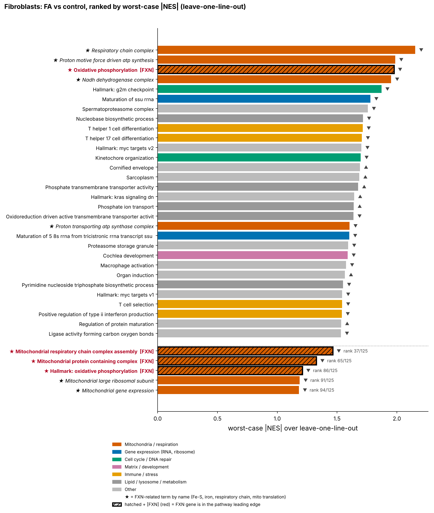

# Bulk RNA-seq pipeline — Friedreich ataxia cell models

An end-to-end, reproducible analysis of bulk RNA-seq from **fibroblasts, iPSC and iNeurons** carrying Friedreich ataxia
(FA) and their **isogenic edited** counterparts: Salmon → tximport → DESeq2 → fgsea, then pathway classification and a
**leave-one-line-out robustness analysis**.



**Results at a glance → [`results_summary/`](results_summary/README.md)**

## What this repository does
1. **Differential expression** with DESeq2: paired design for FA vs edited lines, sex adjustment when appropriate,
   unshrunk and shrunk log2FC, per-contrast QC (PCA, sex check, differentiation markers).
2. **Gene-set enrichment** with fgsea on Wald statistics (Hallmark, GO BP/CC/MF), fixed seed.
3. **Pathway classification** across three contrasts: A = FA vs control, B = edited vs control, C = FA vs edited
   (rescued / persistent / corrected pathways), plus theme plots and heatmaps (`pathway_pipeline/`).
4. **Leave-one-line-out GSEA** (`gsea_loo/`): each pathway is re-tested after removing one line at a time; scores include a
   worst-case NES, per-line contribution and a flag for pathways driven by a single line. With only 3 lines per group this
   separates reproducible signals from line-specific ones.
5. **Figures and tables** from one source (`gsea_loo/02_figures_and_table.py`): rankings, robustness, corrected/persistent
   pathways and cross-model comparison, with the frataxin (FXN) axis highlighted.

## Quick start
```bash
cp config/config.example.R config/config.R      # fill in Salmon paths and the sample sheet
Rscript -e 'source("config/packages.R"); install_missing_packages()'
Rscript run_bulk_pipeline.R                     # DESeq2 + fgsea, writes results_v4/
./run_downstream.sh pathway                     # pathway classification and plots
./run_downstream.sh gsea_loo                    # leave-one-line-out GSEA (R)
./run_downstream.sh figures                     # figures + Excel table (Python: pandas, numpy, matplotlib, openpyxl)
```

## Layout
```
run_bulk_pipeline.R      main pipeline          config/        parameters (config.example.R is a template)
R/                       helper functions       pathway_pipeline/   pathway classification and plots
analysis/                rescue and composition analyses   gsea_loo/    robustness analysis and figures
run_downstream.sh        runs the steps after the main pipeline
```

## Notes
- Sign convention: log2FC and NES > 0 mean higher in the first group named. The output folder `FA_edited_vs_FA`
  keeps its historical name; its log2FC is FA − edited.
- n = 3 lines per group: results are exploratory.
- Input data (Salmon outputs) and results are not included.
- Notes in French: [`README_fr.md`](README_fr.md).

## Author
A-P. Uhart — released under the MIT licence.
