# Guide to the outputs

What each step writes, how it is computed and how to read it. Paths are relative to the project root.
Conventions used everywhere: **A** = FA vs control, **B** = edited vs control, **C** = FA vs edited; log2FC and NES > 0 mean
*higher in the first group named*. **NES** = normalised enrichment score (fgsea); **padj** = Benjamini–Hochberg FDR.
Each cell model has 3 lines per group, so all results are exploratory.
Illustrations below are real outputs, mostly from the **iNeurons** model.

| Step | Command | Writes to |
|---|---|---|
| 1. DE + enrichment | `Rscript run_bulk_pipeline.R` | `results_v4/<model>/` |
| 2. Pathway classification | `./run_downstream.sh pathway` | `results_v4/pathway_ABC/` |
| 3. Rescue and sample-level analyses | `./run_downstream.sh analysis` | `results/…` |
| 4. Leave-one-line-out GSEA | `./run_downstream.sh gsea_loo` | `gsea_loo/out/` |
| 5. Figures and Excel table | `./run_downstream.sh figures` | `plot_enrichment/` |

---

## 1. Main pipeline → `results_v4/<model>/`

`<model>` is `fibro`, `iPSC` or `iNeurons`. One DESeq2 model per contrast, with the design chosen automatically
(paired `~ line + condition` for FA vs edited; `~ sex + condition` or `~ condition` without sex chromosomes otherwise).

| Output | What it is | How to read it |
|---|---|---|
| `QC/` | Global PCA (dotted lines join samples from the same line), sample correlation, sex check (XIST, Y genes), differentiation-marker scores | First stop for outliers and mislabelled samples |
| `<contrast>/<contrast>_DEG_results.csv` | Full gene table: shrunk `log2FoldChange` (apeglm), **unshrunk `lfc_mle`**, stat, p, padj | Use `lfc_mle` for ratios and rescue analyses: shrinkage pulls real effects towards 0 |
| `<contrast>/<contrast>_design.txt`, `_dds.rds` | Design, filter and alpha actually used; the DESeq2 object | Required by steps 3 and 4 |
| `<contrast>/*_diag_*.pdf` | Dispersion plot, MA plot, p-value histogram | A flat histogram with a peak near 0 is healthy |
| `<contrast>/*_PCA_*`, `_volcano*`, `_heatmap*` | Standard figures | |
| `<contrast>/*_<collection>_fgsea.csv` | fgsea table: `pathway, NES, pval, padj, size, leadingEdge` | The leading edge is the subset of genes driving the score |
| `RESCUE_RATIO/` | Per FA-DEG: LFC(FA vs edited) / LFC(FA vs control) | A distribution, not a test: biased towards 0 because genes are selected for a large FA effect |
| `PAIRED_DEG_CLASSIFICATION/` | Paired-contrast DEGs labelled `FA-specific`, `edited-clone`, `ambiguous`, `non-testable` | Heuristic with a ratio threshold, not a statistical test |
| `<model>_DEG_summary.csv` | Number of DEGs per contrast, shrunk vs unshrunk LFC | |

At the top level of `results_v4/` (not per model): `CROSS_*`, `iPSC_vs_iNeurons/` and `DiseaseEffect_*` (cross-dataset comparisons), `CONCORDANCE/` (Spearman correlation of Wald statistics and of NES between datasets: threshold-free agreement between models), and `config_snapshot.R` + `sessionInfo.txt` (exact configuration and package versions of the run, for reproducibility).

**Pitfall.** The folder `FA_edited_vs_FA` has a historical name: its log2FC is **FA − edited** (positive = higher in FA).

### Examples (iNeurons)

**`QC/<model>_PCA_global.pdf`: global PCA.** Top 500 variable genes (VST). Dotted lines join samples from the same line
(e.g. an FA line and its edited counterpart); shape = sex, colour = condition.
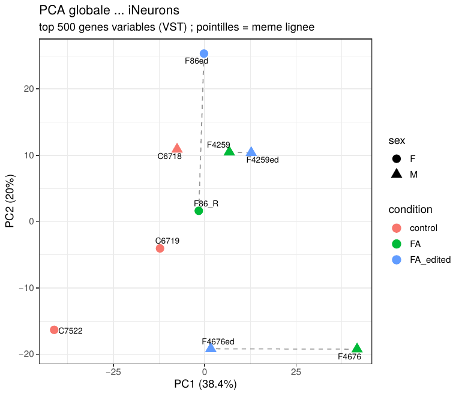

**`QC/<model>_sex_check.pdf`: sex check.** Expression of Y-linked genes and XIST per sample, with the declared sex on top;
a sample whose profile contradicts its label is flagged here.
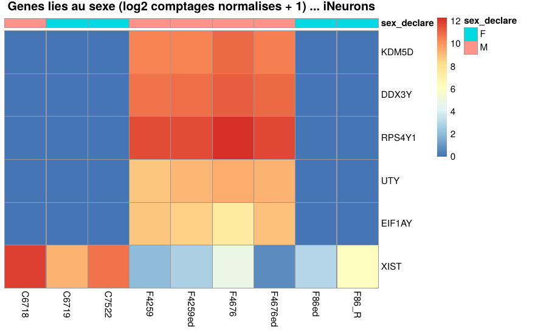

**`QC/<model>_differentiation_scores.pdf`: differentiation scores.** Mean log2 normalised counts of marker groups
(forebrain, glutamate, neurons, pluripotency, progenitors…) per sample, by condition, to spot atypical samples.
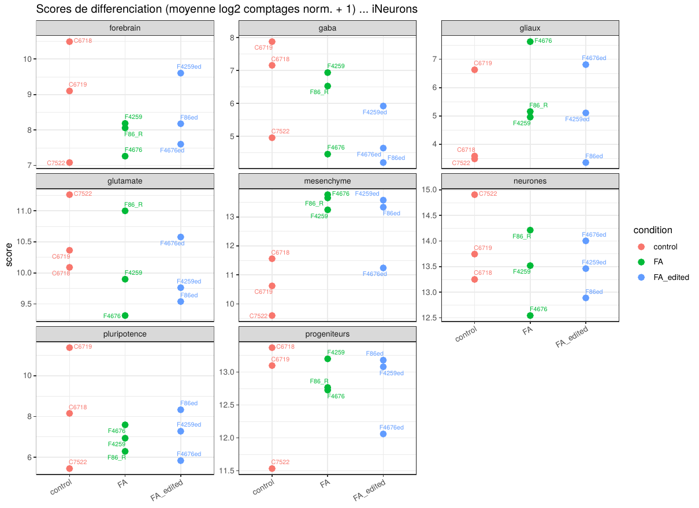

**`<contrast>/*_diag_pvalue_hist.pdf`: p-value histogram.** A peak near 0 on a roughly flat background indicates real signal and a well-calibrated test.
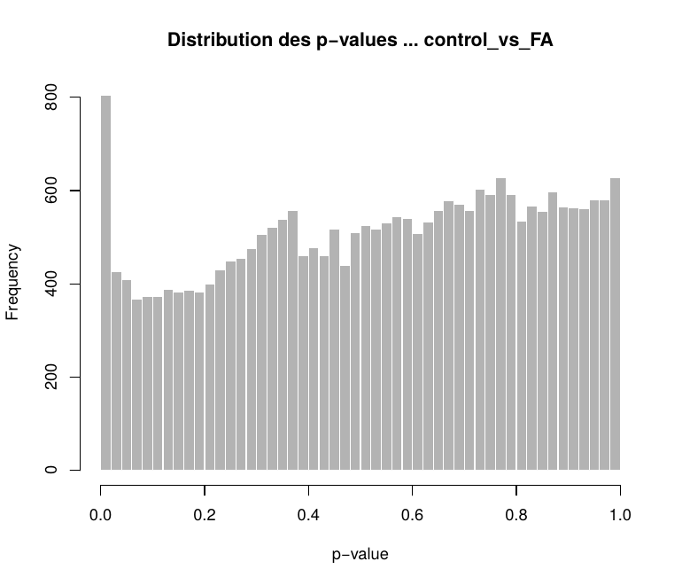

**`<contrast>/*_diag_MA.pdf`: MA plot (unshrunk LFC).** Each dot is a gene: mean expression on x, log2 fold change on y; blue = significant.
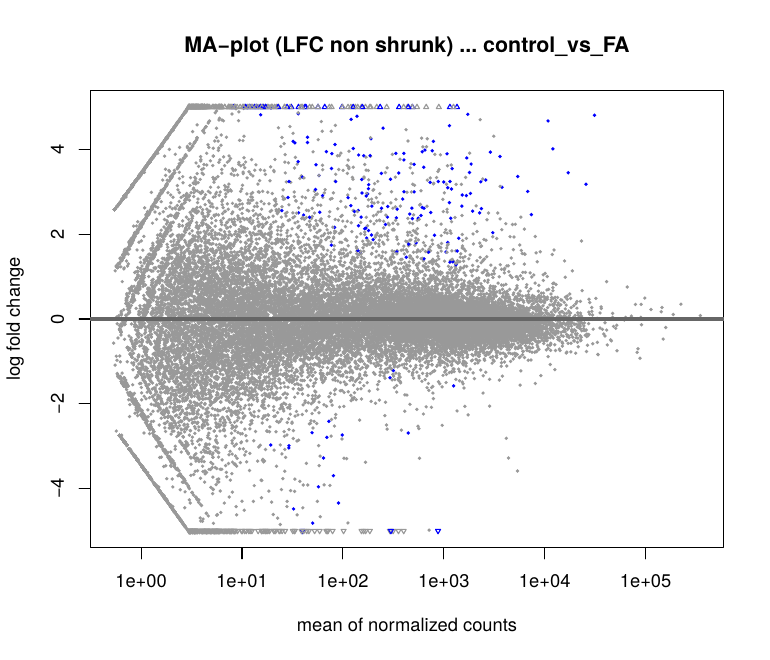

**`<contrast>/*_PCA_2D.pdf`: PCA of the samples in the contrast.**
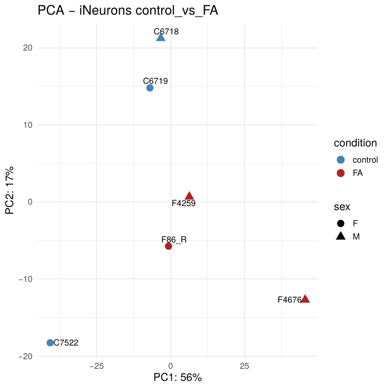

**`RESCUE_RATIO/<model>_rescue_ratio_hist.pdf`: rescue ratio of FA-DEGs.** LFC(FA vs edited) / LFC(FA vs control) for each FA-DEG.
0 = no change after editing, 1 = full return to the control level (clipped to −1 / 2). Read it as a distribution, not a test.
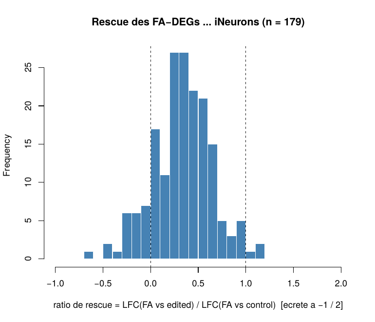

**`PAIRED_DEG_CLASSIFICATION/<model>_paired_deg_classification.pdf`: FA-specific or clone effect?** x = LFC FA − control, y = LFC edited − control.
Genes on the axis y = 0 are corrected by editing (`FA-specific`); genes on the axis x = 0 differ in the edited clone but not in FA (`edited clone`).
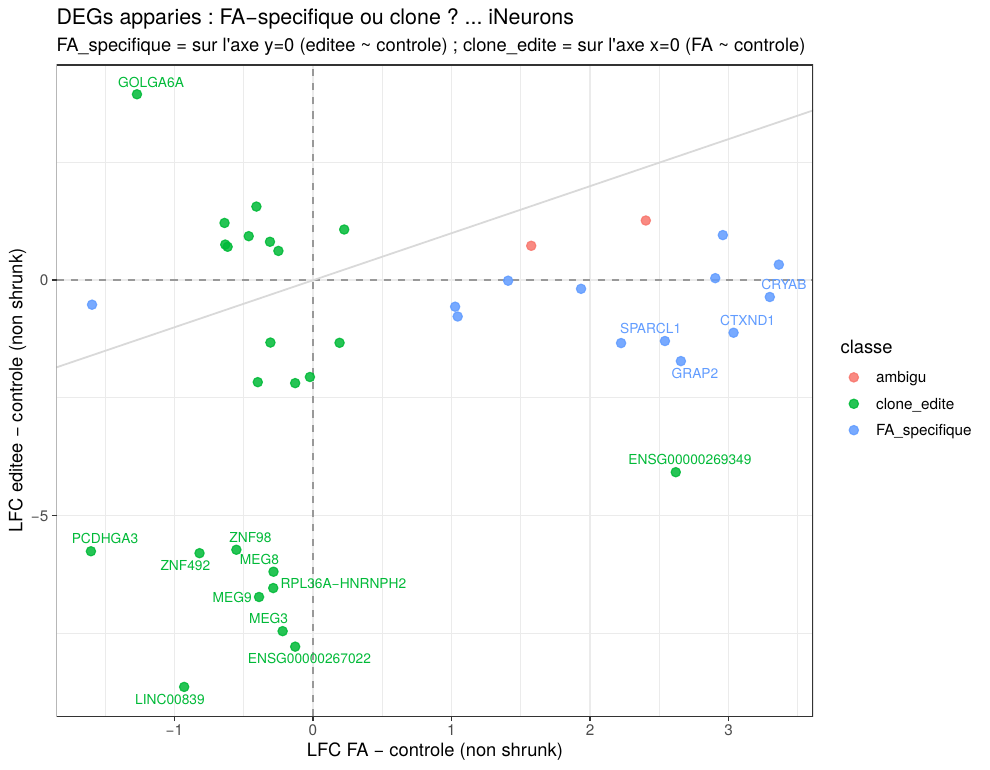

---

## 2. Pathway classification → `results_v4/pathway_ABC/`

Combines the fgsea results of A, B and C for each model.

| Output | What it is |
|---|---|
| `Pathways_ABC_<model>_all.csv` | Every pathway with NES, padj and leading edge in each contrast, and a class label |
| `Pathways_ABC_<model>_candidates.csv`, `_clusters.csv` | Candidate pathways (size window, EMT filtering) and their grouping by overlapping leading edges |
| `Pathways_ABC_shared_iPSC_iNeurons.csv` | Pathways significant in both models |
| `Pathways_ABC.xlsx` | The same tables as sheets |
| `rescue_map_NES_A_vs_C.(png|pdf)` | Scatter of NES in A against NES in C, one panel per model. Points near the diagonal y = x are pathways that change in FA and come back after editing |
| `theme_plot_rescued`, `theme_plot_edited_shift` | The same scatter coloured by theme (ribosome, mitochondria, synapse, matrix…). The second plots B against C: if A ≈ 0, points fall on y = −x |
| `theme_heatmap.(png|pdf)`, `theme_heatmap_data.csv` | Theme × contrast heatmap: colour = mean NES of the theme's pathways, number = significant pathways / pathways in the theme |
| `novel/` | Pathways that follow the A/B/C trend of reference pathways: `New_pathways_following_reference_trends.xlsx`, per-group heatmaps, trend profiles and leading-edge networks |
| `module_scores_<model>.(csv|png|pdf)` | Per-sample module score (mean z-scored VST of the leading-edge genes of chosen pathways) for control / FA / edited |
| `gene_heatmap_<model>.(csv|png|pdf)` | Per-sample heatmap of selected genes, row z-scored VST |

### Examples (iPSC and iNeurons)

**`rescue_map_NES_A_vs_C.png`: rescue map.** NES in A (x) against NES in C (y). A pathway that is down in FA and goes back up after editing
lies near the diagonal y = x.
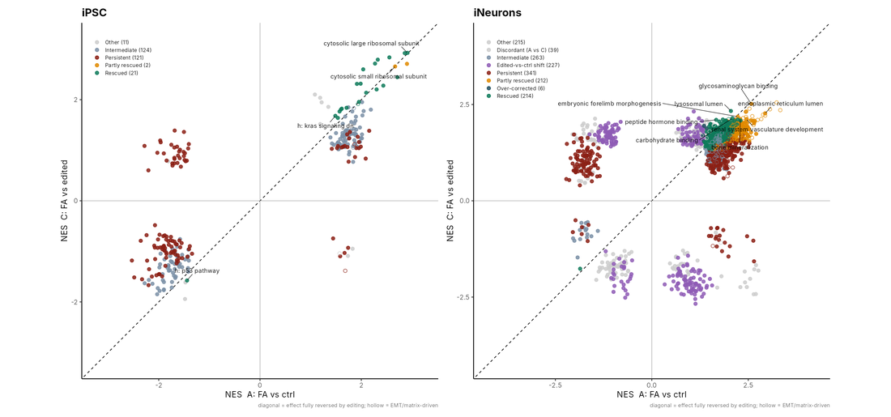

**`theme_plot_rescued.png`: rescued pathways coloured by theme.** The same plot restricted to rescued pathways (n = 20 in iPSC, 203 in iNeurons), coloured by theme.
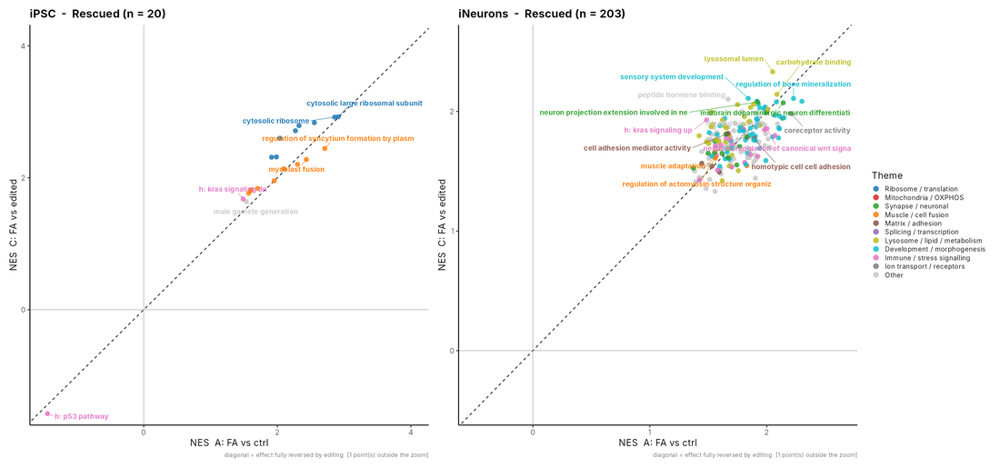

**`theme_heatmap.png`: theme × contrast overview.** Colour = mean NES of the theme's pathways; the number shows significant pathways / pathways in the theme.
In this example, mitochondria / OXPHOS is down in A and B in iPSC, and ribosome / translation goes in opposite directions in iPSC and iNeurons.
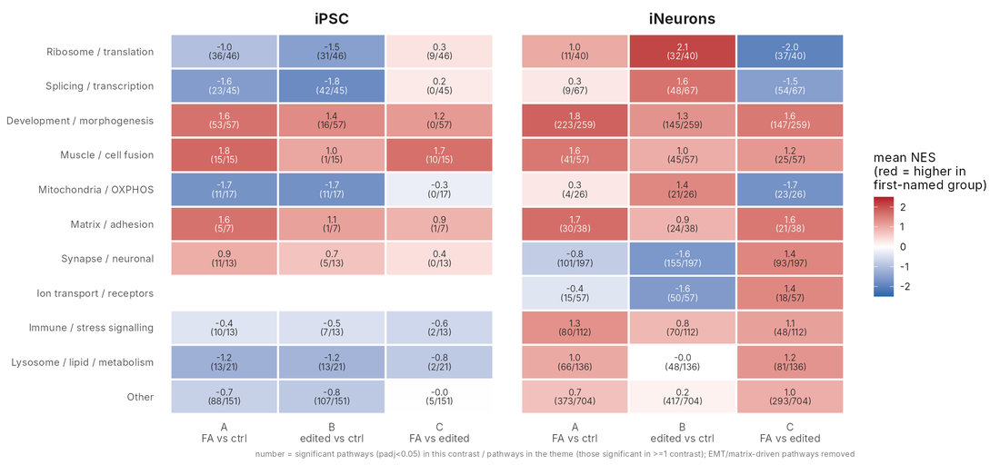

**`module_scores_<model>.png`: module score per sample.** Control → FA → FA_edited trajectories (grey lines join a line to its edited version) for
modules built from leading-edge genes (OXPHOS, cytosolic ribosome, Fe-S cluster assembly, synapse).
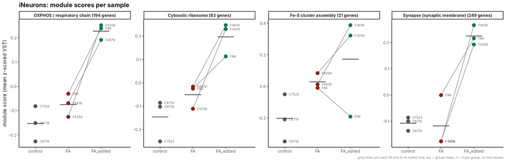

---

## 3. Rescue and sample-level analyses → `results/`

| Script | Output | What it answers |
|---|---|---|
| `40_gsea_rescue_classification.R` | `results/gsea_rescue_classification/40_classification_toutes.xlsx`, `40_*_classification.csv`, `40_summary_counts.csv`, `40_focus_pathways.pdf` | For each pathway with an FA deficit: **restored** (edited ≈ control), **partially corrected**, **overcorrected** (beyond control), or **not corrected**. Pathways without a deficit are tagged as responding to editing or unaffected. The focus PDF shows the Control → FA → Edited trajectory |
| `42_rescue_composition_split.R` | `results/rescue_composition_split/42_rescued_genes_classified.csv`, `42_summary.(csv|pdf)` | Which "rescued" iNeuron genes just follow **cell composition** (correlation with a mesenchymal score) and which are consistent across the three FA/edited pairs |
| `51_rescue_tables_ipsc_ineurons.R` | `results/rescue_tables/51_rescue_tables.xlsx`, `51_rescue_<model>.csv` | Gene-level table: rescued / partial / reversed / not rescued, the three LFCs, number of pairs moving the right way, a readable `Confidence` column |
| `52_paired_rescue_allgenes.R` | `results/paired_rescue/iNeurons/52_paired_rescue_all_genes.csv`, `52_candidates.xlsx`, `52_paired_rescue.pdf`, `52_verdict.txt` | Genes that return towards control reproducibly in all three donors, without an amplitude threshold. **Tier 1/2** candidates are compared with a reversed-direction null to estimate how many would appear by chance or clone effect |
| `54_pathway_sample_level_tests.R` | `results_v4/pathway_ABC/pathway_sample_tests_<model>.csv` | Replicate-aware tests complementing fgsea: Welch (A, B) or paired (C) t-test on a per-sample module score, and a `limma::fry` rotation test. `lines_concordant` = lines (of 3) whose effect has the sign of the mean |

### Example

**`52_paired_rescue.pdf`: paired rescue on all genes (iNeurons).** x = LFC FA vs control, y = LFC edited vs FA (paired model). Genes in the lower right
or upper left move back towards the control level after correction; Tier 1 and Tier 2 candidates are highlighted, and genes that follow cell
composition are marked separately.
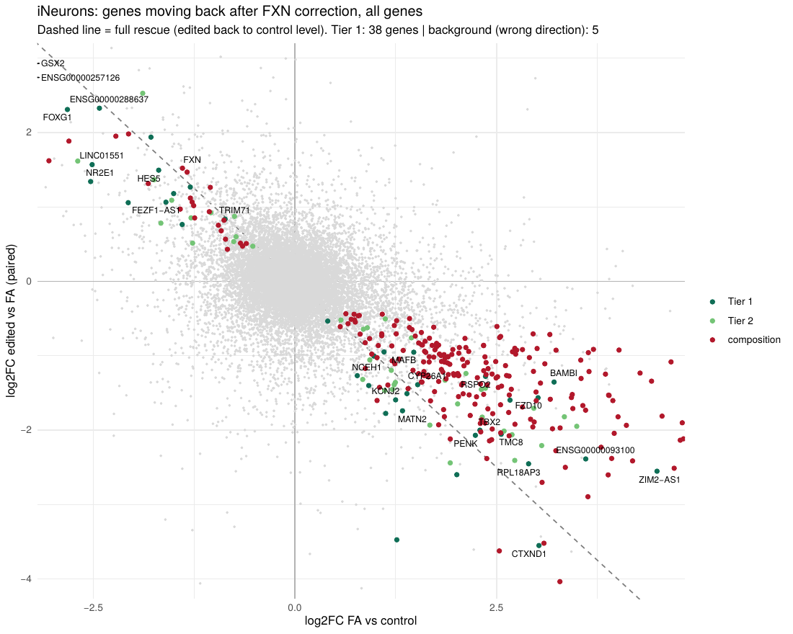

---

## 4–5. Leave-one-line-out analysis → `gsea_loo/out/`, `plot_enrichment/`

With only three lines per group, a strong enrichment can come from a single line. The GSEA is therefore repeated on all
samples and again after removing one line at a time (4 runs per contrast), and every figure and table comes from these
same files.

### Per-contrast CSV (`gsea_loo/out/<model>_<A|B|C>.csv`)
`pathway, collection, size, leadingEdge` plus `NES|run`, `pval|run`, `padj|run` for `run` = `all`, `without_<line>`.

### Excel table `plot_enrichment/Pathways_leave_one_line_out.xlsx`
One sheet per model and contrast, plus `Légendes` (column dictionary) and `Résumé` (counts). Main columns:

| Column | Meaning |
|---|---|
| `NES_all`, `padj_all` | Result on all lines |
| `NES_without_X`, `padj_without_X` | Result after removing line X |
| `worst_case_NES_signed` | Smallest |NES| over all runs, with the sign of the full NES; **0 if the sign flips** |
| `n_LOO_padj<0.05` | Number of removals where the pathway stays significant |
| `robust` | Significant on all lines, same sign after every removal, and nominal p < 0.05 after every removal |
| `contrib_X` | Loss of |NES| when X is removed (full NES − NES without X, oriented along the full NES). ≈ 0: X is neutral; large: X carries the signal; negative: X pulls the other way |
| `driver_line`, `driver_share` | Line with the largest contribution, and its share of the summed positive contributions (≈ 1/3 balanced, ≈ 1 one line) |
| `single_line_driven` | Significant overall, but the sign flips or nominal p ≥ 0.05 after removing at least one line |
| `FXN_in_leading_edge`, `FXN_related_name` | FXN gene in the leading edge / name suggests the frataxin axis (Fe-S, iron, respiratory chain, mitochondrial translation) |

**What a sheet looks like** (`iNeurons_A`: three robust pathways, then two whose signal depends on one line, e.g. *synaptic membrane*, where removing line 4676 drops |NES| from 1.78 to 1.19):
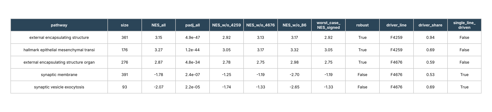

### Figures
Common to all bar figures: pathways with padj < 0.05, 15–300 genes, redundant pathways merged (leading-edge Jaccard > 0.6;
pathways with FXN in the leading edge are always kept). Colour = theme (orange = mitochondria/respiration);
**▲/▼** = higher/lower in the first group; **★** = FXN-related by name; **hatched + black frame + red `[FXN]`** = FXN is in the
leading edge. Below the dotted line, the best-ranked FXN-related pathways with their `rank x/N` (N after merging).

**`ranking/ranking_FDR_<model>_<contrast>.png`: ranked by −log10(FDR).** Answers "what changes most reliably?". The dashed
line marks the best FXN pathway, so everything to its right is at least as significant as the frataxin axis.
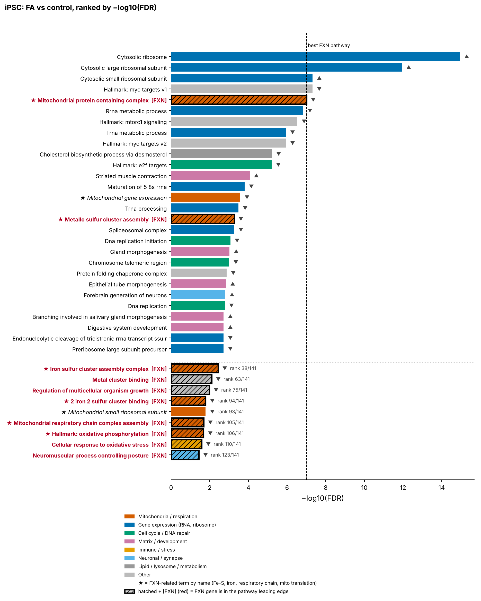

**`ranking/ranking_NES_<model>_<contrast>.png`: ranked by |NES|.** Same filters, ranked by effect size instead of significance;
large NES can come from small gene sets, so read it next to the FDR version.
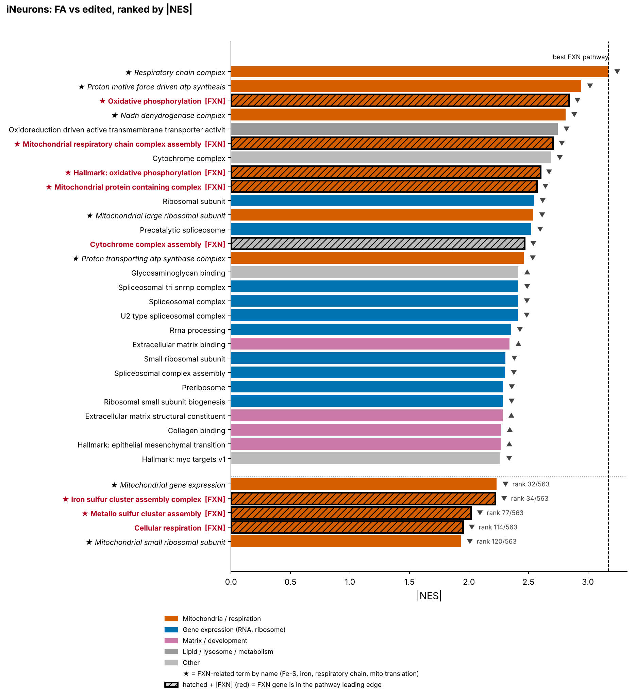

**`robust/robust_<model>_<contrast>.png`: ranked by worst-case |NES|.** A pathway only scores high if it stays strong after
*every* line removal. Fibroblasts (A) and iNeurons (C) are shown in the main summary:
[fibroblasts](../results_summary/robust_Fibroblasts_A.png), [iNeurons FA vs edited](../results_summary/robust_iNeurons_C.png).

**`persistent/persistent_<model>.png`: pathways that stay altered after editing.** Significant in A and in B with the same
sign, ranked by |NES| of B. These are changes editing does not fix (line background, clonal effects, or an incomplete correction).
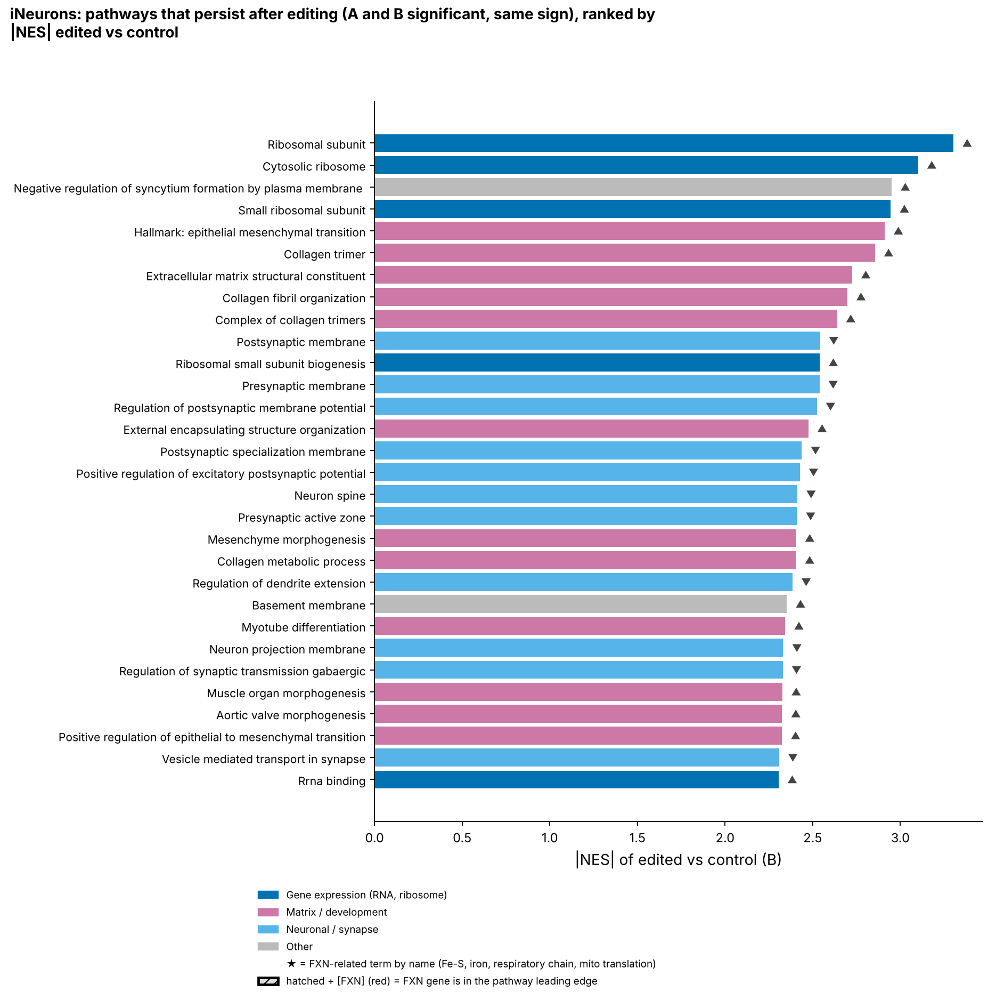

**`corrected/corrected_<model>.png`: pathways corrected by editing.** Significant in A and C with the same sign, **not** significant
in B: the signal disappears once FXN is restored. This is the figure closest to a "frataxin-dependent" readout.
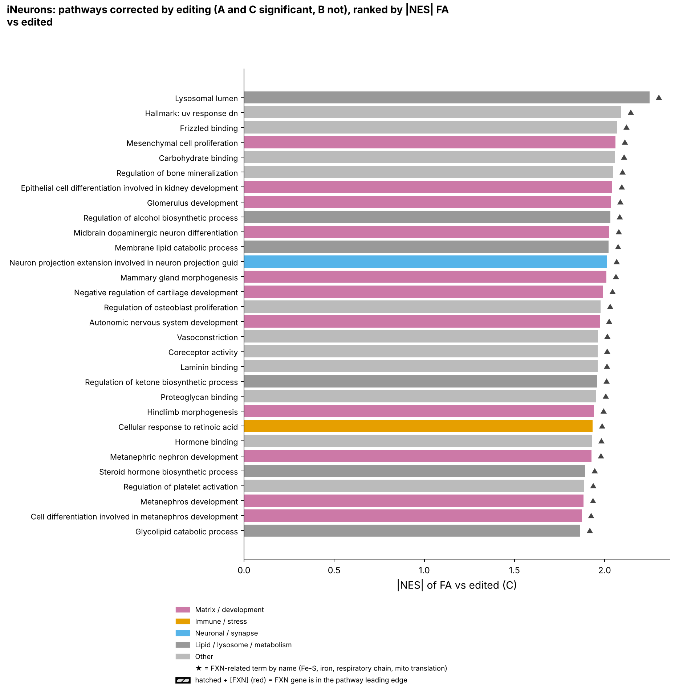
In iPSC this set is small; see [`results_summary`](../results_summary/README.md).

**`partage_entre_modeles.png`: shared across models.** Contrast A in fibroblasts, iPSC and iNeurons side by side; bars faded when
not significant in that model. Ranked by the number of models in which the pathway is significant in the same direction.
See [`results_summary`](../results_summary/README.md) for how to read the opposite-direction ribosomal terms.

### Caveats that apply to every figure
- Counts in the figures are smaller than the raw tables because of the size window and the redundancy merge.
- Contrast B has its own leading edge; A and C use theirs.
- Pathways dominated by mesenchymal/matrix genes in iNeurons may reflect cell-type composition, not frataxin biology.
- `robust` and `worst_case_NES_signed` rely on only three lines: use them to rank confidence, not to claim significance.
