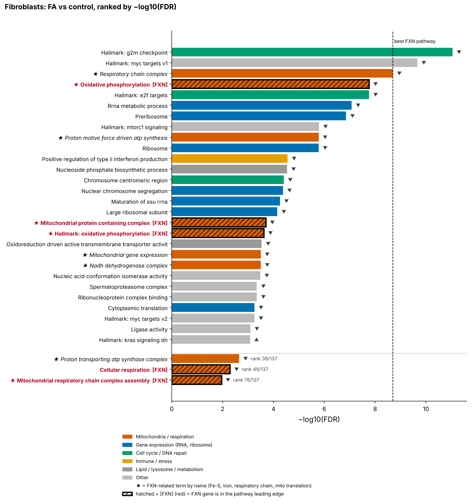
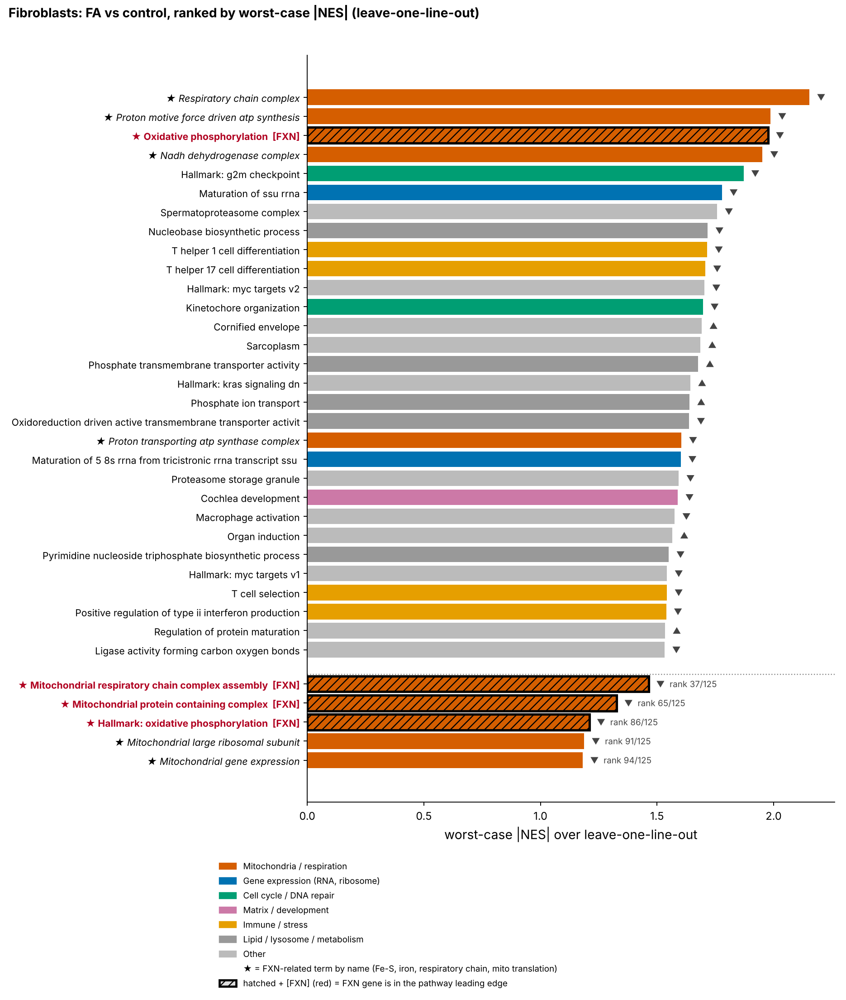
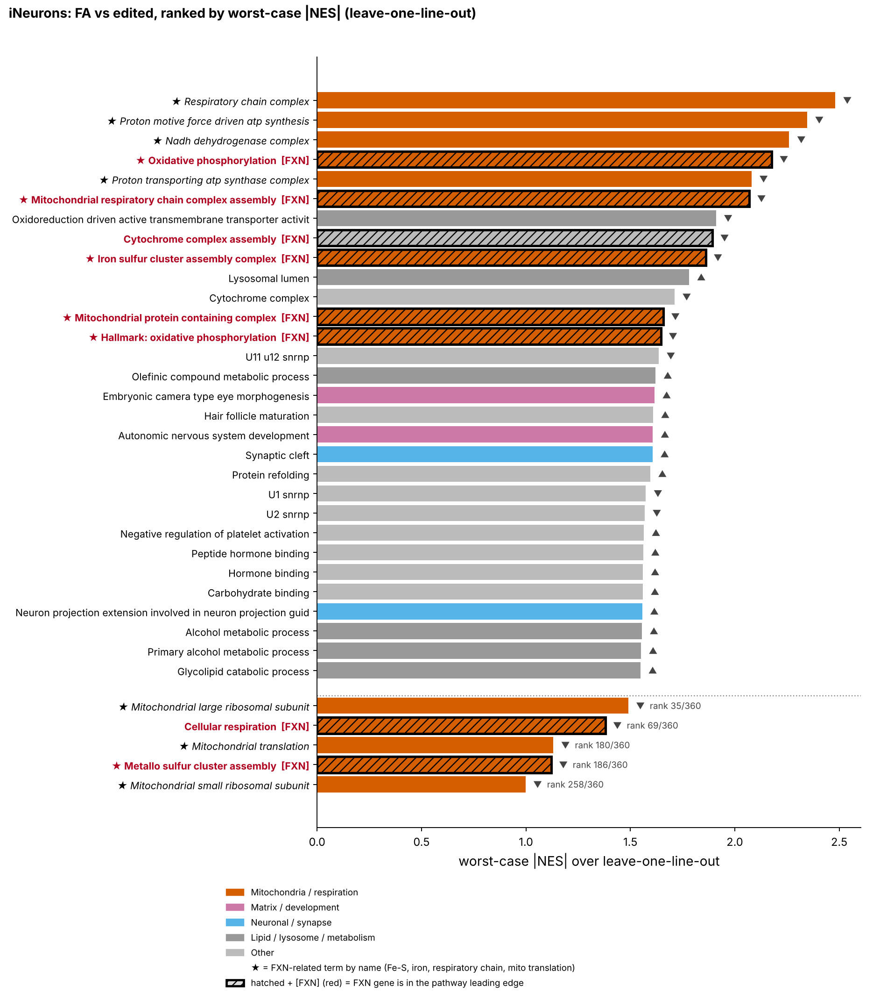
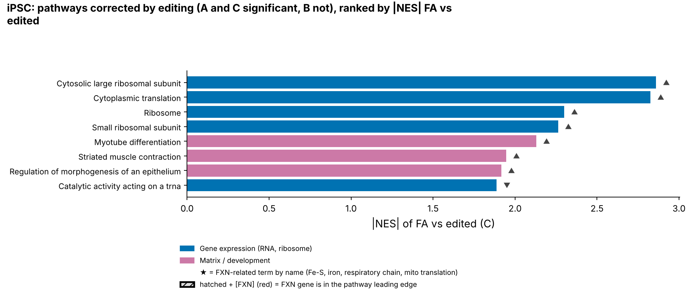
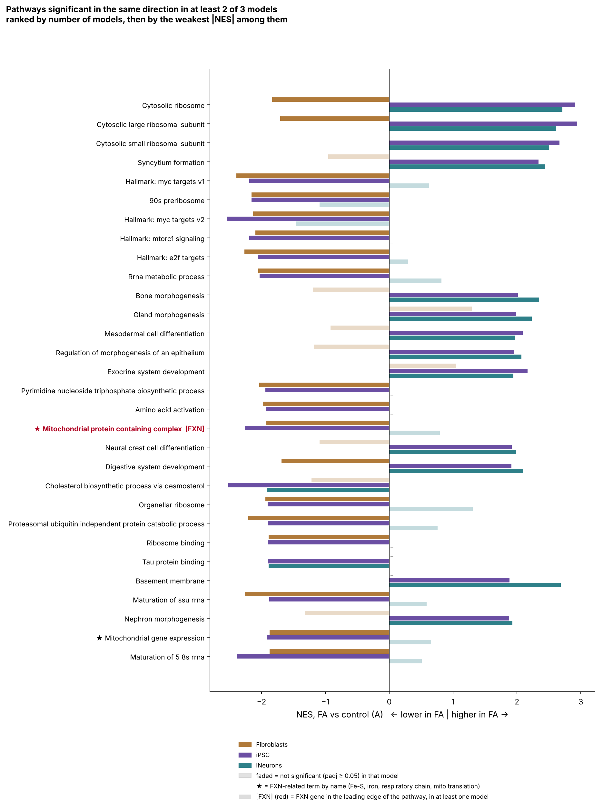

# Selected results

Bulk RNA-seq, Friedreich ataxia (FA) cell models: fibroblasts (3 control, 3 FA), iPSC and iNeurons (control, FA and
isogenic FA_edited lines, 3 lines per group). Gene-set enrichment (fgsea; Hallmark and GO BP/CC/MF) on DESeq2 Wald statistics.
Contrasts: **A** = FA vs control, **B** = edited vs control, **C** = FA vs edited. NES > 0 means higher in the first group.
With n = 3 per group these results are exploratory.

**How to read the figures.** Bars are pathways (padj < 0.05, 15–300 genes, redundant pathways merged);
▲/▼ = higher/lower in the first group; ★ = name suggests the frataxin (FXN) axis (Fe-S, iron, respiratory chain,
mitochondrial translation); hatched with red `[FXN]` = the FXN gene is in the pathway leading edge.

---

## 1. Mitochondrial respiration is down in FA fibroblasts, alongside proliferation and ribosome-biogenesis terms

Ranked by −log10(FDR). Oxidative phosphorylation (FXN in the leading edge) and respiratory-chain terms are
down in FA, together with G2M checkpoint, MYC targets and ribosome biogenesis.

## 2. Is this robust to dropping one line? (leave-one-line-out)

The score is the worst-case |NES| over all analyses obtained by removing one FA line at a time (0 if the sign flips).
In fibroblasts, respiratory-chain and OXPHOS terms stay at the top; with three lines per group, a high score can come
from a single line, which is why this ranking exists.

## 3. Pathways ranked by robustness, FA vs edited (iNeurons)

Respiratory-chain and Fe-S assembly terms with FXN in the leading edge are among the most robust pathways
when the FA lines are compared with their edited counterparts.

## 4. Pathways corrected by editing (iPSC)

Significant in A (FA vs control) and C (FA vs edited), not in B (edited vs control): the signal goes away after
correcting FXN. In iPSC these are mostly cytosolic ribosome / translation and muscle-development terms.

## 5. What is shared across models?

Pathways significant in the same direction in at least two of the three models. No pathway reaches significance
in the same direction in all three. Ribosomal terms go in opposite directions in fibroblasts and in iPSC/iNeurons.

---
Figures are regenerated by `gsea_loo/02_figures_and_table.py` from the output of `gsea_loo/01_gsea_loo.R`.
